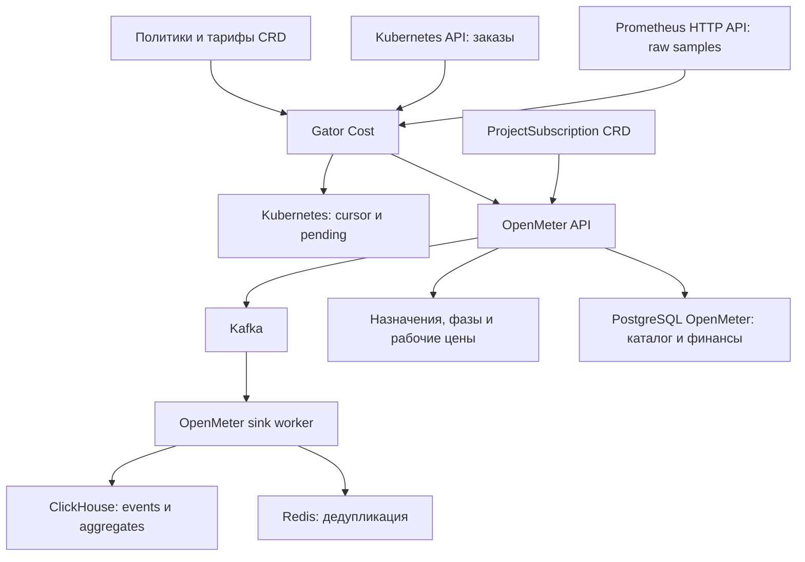
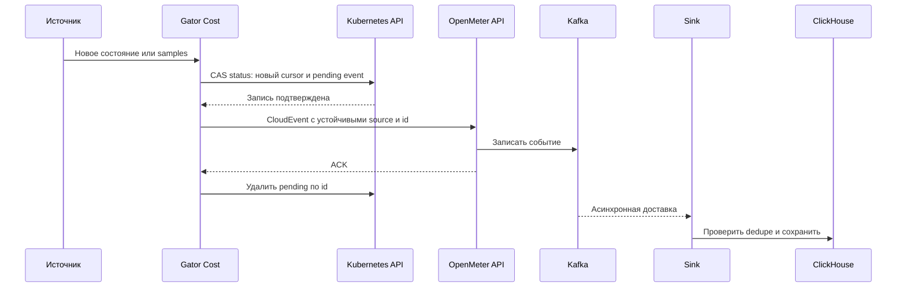
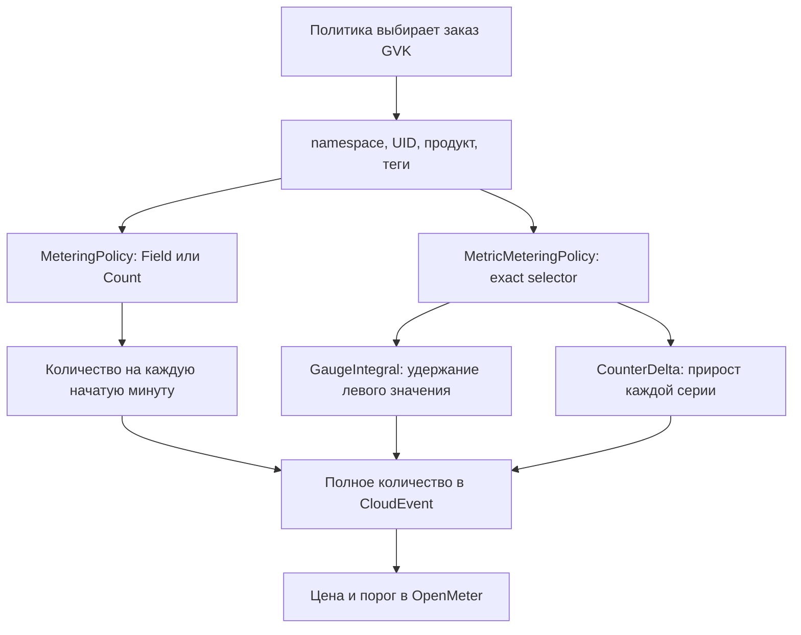

# Архитектура и потоки данных

## Измерение и тарификация

Gator Cost не вызывает облачный API для определения количества и не управляет
жизненным циклом исходных заказов. Для CR используется Kubernetes discovery и
list/watch. Для метрик GVK задаёт доверенную идентичность, а TSDB — количество.

API OpenMeter принимает стандартные CloudEvents и передаёт их в Kafka. Sink
записывает события и агрегаты в ClickHouse с дедупликацией через Redis.
Финансовые API/работники OpenMeter используют свою PostgreSQL для customers,
каталога, charges, credits и invoices. Kafka — транспорт, не архив истории.

## Где что хранится

| Данные | Авторитетное место | Срок / особенность |
| --- | --- | --- |
| Желаемые правила и тарифы | Kubernetes CRD `spec` | Управляются администратором |
| Последняя принятая конфигурация | `CollectorCheckpoint` | Текущий снимок для валидации, не журнал версий |
| Активные CR-сессии и `next` | `CollectorCheckpoint` | Переживают рестарт writer |
| Последняя точка каждой raw series | `CollectorCheckpoint` | Baseline и курсор, не полная история samples |
| Ещё не подтверждённые события | `CollectorCheckpoint.pending` | Удаляются после доставки |
| Usage, принятые тарифы, issues и архив | OpenMeter / ClickHouse | Автоматическое удаление истории не настроено |
| Native Plans, Features, Customers, Subscriptions, Charges и invoices | PostgreSQL OpenMeter | Финансовое состояние OpenMeter |
| Dedupe IDs | Redis OpenMeter | В поставке 32 дня |
| Транспортные сообщения | Kafka | Retention ограничен, в поставке 7 дней |
| `CostReport` запрос/результат | Kubernetes | TTL один час, исходная история остаётся |
| `PriceList` | Kubernetes | Пересоздаваемая проекция принятой истории |

Техническое имя PostgreSQL Service может остаться `gator-cost-postgresql` после
миграции. Это не означает наличия базы Gator Cost: сервер обслуживает базу
`openmeter`, принадлежит её Helm release и сохраняет прежний PVC.

## Атомарная точка восстановления

Курсор и событие меняются одним `UpdateStatus` с `resourceVersion`. Если запись
не удалась, курсор не продвинут. Если потерян ответ OpenMeter или процесс умер
до удаления pending, повтор отправляет те же `source/id`. Дедупликацию выполняет
OpenMeter. Это условная защита в пределах сохранённого dedupe state, а не
безусловная гарантия exactly-once после потери Redis.

Для событий принятия/отзыва тарифов есть дополнительный шаг: контроллер ждёт,
пока событие видно через OpenMeter event API. До подтверждения нового тарифа
измерения не продвигаются по старому cache. После подтверждения cache сбрасывается.

Очередь ограничена 256 событиями и 650 KB status на checkpoint. Переполнение
останавливает продвижение с ошибкой; подтверждённая история не накапливается
в Kubernetes. Автоматическая отправка события старше 31 дня блокируется до сверки.

## Один writer

В служебном namespace используется Lease `gator-cost-collector`: срок 30 секунд,
обновление каждые 5 секунд; после длительной потери продления writer запрещает
новые записи и завершает процесс. Metric loop и доставка останавливаются до
освобождения lease. Kubernetes CAS дополнительно защищает checkpoint от
потерянных параллельных обновлений.

При обновлении используется один collector. Увеличение replicas не превращает
сборщик в шардированный кластер: одновременно писать разрешено одному экземпляру.

## Два способа получить количество

CR-учёт измеряет заявленное количество внешнего ресурса, а не загрузку CPU/RAM
по Kubernetes metrics. Gauge/counter используют фактические samples с задержкой,
без экстраполяции `rate()`/`increase()`. Начальное накопленное значение counter
становится baseline. Потерянные между scrape/reset/cache eviction операции
не восстанавливаются из воздуха.

## Отчёты не являются новой записью потребления

`CostReport` читает агрегаты и raw events через OpenMeter API. Unit-потребление
рейтингуется invoice simulation по историческим ставкам. Для месячного порога
сначала рассчитывается последовательное накопленное потребление всего проекта;
разности upstream totals распределяются по измерениям, затем применяются фильтры.
Поэтому фильтр метки/заказа не выдаёт лимит повторно.

Simulation не создаёт usage, charge или invoice. `CostReport.totalCost` —
предварительная стоимость; выпущенный invoice остаётся финансовым документом.
