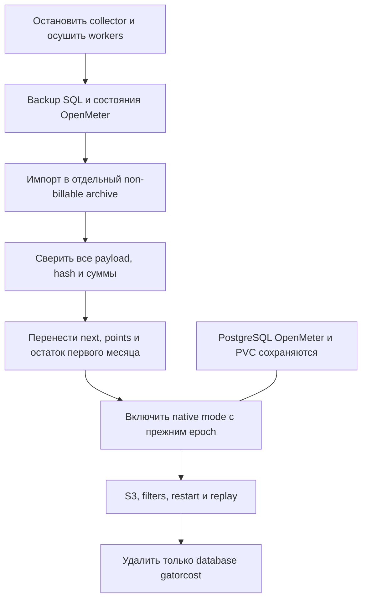

# Эксплуатация, диагностика и миграция

## Права доступа

Разделяйте администратора правил, служебный writer и клиента отчётов.

| Участник | Доступ |
| --- | --- |
| Администратор биллинга | Управление CostConfiguration, политиками и тарифами |
| ServiceAccount Gator Cost | Чтение CRD/источников/namespaces, запись служебных checkpoints/Lease и status/projections |
| Клиент проекта | Create/get/list/watch CostReport, read-only PriceList в своём namespace |
| Оператор OpenMeter | Административный доступ к native API/финансовым хранилищам |

Source RBAC перечисляется по точным GVR. Credential metrics API выдаётся отдельным
`get` Secret по имени. Tenant не получает CollectorCheckpoint, Lease, тарифные
мутации или прямой административный OpenMeter API.

Пример роли клиента без привязки к пользовательской консоли:

```yaml
apiVersion: rbac.authorization.k8s.io/v1
kind: Role
metadata:
  name: billing-reader
  namespace: billing-lab
rules:
  - apiGroups: [cost.gatorstack.dev]
    resources: [costreports]
    verbs: [create, get, list, watch]
  - apiGroups: [cost.gatorstack.dev]
    resources: [pricelists]
    verbs: [get, list, watch]
```

RoleBinding назначают существующему пользователю/группе/ServiceAccount проекта.
Write к status остаётся у контроллера. Разрешение читать исходный заказ отдельно
от доступа к его историческому отчёту.

## Проверка цепочки

```sh
oc --context "$GATOR_CONTEXT" get costconfiguration default -o yaml
oc --context "$GATOR_CONTEXT" get meteringpolicies,metricmeteringpolicies
oc --context "$GATOR_CONTEXT" get tariffplans
oc --context "$GATOR_CONTEXT" -n billing-lab get projecttariffplans,pricelists
oc --context "$GATOR_CONTEXT" -n gator-cost get deploy,pods,collectorcheckpoints,leases
oc --context "$GATOR_CONTEXT" -n openmeter get deploy,pods,pvc,cronjobs
```

Проверяйте observedGeneration/conditions политик, свежесть points, возраст pending,
ошибки delivery, Kafka lag, sink, место ClickHouse и состояние Redis. `healthz`
показывает живой процесс; Ready одного API не доказывает, что финансовый поток
полностью записан и рассчитан. Отдельного Prometheus endpoint со всеми этими
сигналами Gator Cost сейчас не публикует: состояние доступно через CRD/логи,
метрики инфраструктуры — через установленный мониторинг.

Для чтения native количеств/charges используйте
[проверенные API-запросы](openmeter.md#чтение-api).
Не печатайте Secret data, DSN, bearer или конфигурацию OpenMeter с credentials.

## Типовые ситуации

| Признак | Проверить / действие |
| --- | --- |
| `SourceUnavailable` | Discovery GVR/version, scope, source RBAC, доступ API server |
| `InvalidResource` | CEL, JSON Pointer, тип/единицу количества, обязательные metadata |
| `Conflict` / `MetricConflict` | Пересечение policy на тот же UID и chargeKey/metric id |
| `MissingTariffPlan` | Семейство ref, acceptedAt, даты и отзыв |
| `TariffConflict` | Пересекающиеся глобальные/проектные версии |
| `MissingRate` | Полный набор rates проектного override; fallback по отдельным ключам отсутствует |
| `IncompatibleUnit` | CR base unit + `-minute` либо точную metric unit |
| `MetricMissing`, ожидание baseline | Есть ли реальные samples/counters; маленький PUT/GET, scrape и delay |
| `MetricIdentity` | Уникальные свежие bucket+owner+backend labels witness |
| Stale/gap/partial | Scrape, exporter cache, TSDB retention, maxSampleAge/maxCatchUp |
| Outbox full / checkpoint too large | Восстановить OpenMeter delivery; проверить размер/число pending и конфигурации |
| Событие старше safety window | Сверка принятых ID перед replay, не обходить защиту сменой epoch |
| `native charge price differs` | Цена внутри месячного периода поменялась; согласовать переход на границе месяца |
| `CalculationUnavailable` | API/агрегация/simulation; сократить период, выбрать DAY; отчёт повторяется |
| Raw event с validationError | Наличие соответствующего meter/customer и корректный wire-контракт |

Готовый baseline не гарантирует, что выгрузка клиента и счётчик экспортера имеют
одинаковую семантику байтов. Сверяйте определение метрики и фактическое количество.
Не заменяйте неизвестный расход нулём и не удаляйте checkpoint ради зелёного status.

## Проверка нового измерения

1. Подготовьте изолированный namespace и полный тариф; проверьте принятые версии.
2. Для CR измените billable condition и quantity; проверьте начатые минуты и
   динамический класс без создания нового meter на каждую смену класса.
3. Для метрик дождитесь всех baseline, затем создайте известный объём.
4. Сверьте raw quantity, native Feature/Charge price и realtime totals.
5. Разделите объём между двумя заказами: free tier должен остаться общим.
6. Повторите отчёт с orderUID/меткой: сумма долей должна совпасть с общим итогом.
7. Перезапустите collector; cursor и счётчики не должны дать повторный расход.
8. Проверьте восстановление после потерянного ACK на отдельном тестовом subject;
   повтор должен сохранить source/id и не увеличить meter/charge quantity.
9. Очищайте свои fixtures, сохраняя уже учтённую историю. Проверяйте удаление на
   стороне провайдера, а не только исчезновение CR.

## Переход с базы gatorcost

Миграция относится к архитектуре 0.1–0.6 с собственной SQL-базой.
Не нужна для новой установки. Требуется окно обслуживания и доступ к backup.



### 1. Остановите старые записи и сохраните данные

Остановите collector/admin UI, дождитесь доставки старого outbox, затем остановите
SQL workers. Закрытые сессии должны быть обработаны. Сохраните защищённые pg_dump
баз `gatorcost` и `openmeter`, конфигурацию и согласованные backup других хранилищ.
Не выводите credentials в аргументы/журналы; используйте существующий доступ
внутри PostgreSQL Pod и защищённые файлы вне Git.

Мигратор не удаляет БД. Он проверяет пустой outbox, получает writer lock,
сохраняет исходный count/hash, архивирует durable usage и старые metadata,
сравнивает суммы всех явно настроенных pricing subjects. Старые финансовые
events/charges/invoices остаются на своих местах. Интервальный архив ранней
версии сохраняется как legacy metadata events; CostReport работает с durable
usage OpenMeter, а не пересчитывает старую OpenCost-модель в новые charges.

### 2. Запустите migration mode

До смены конфигурации оставьте legacy DSN Secret ref и временный RBAC для мигратора.
Обновите CRD и Role на CollectorCheckpoint/Lease. Пример Job; замените тег образом
с поддержкой 0.7 и добавьте imagePullSecrets при необходимости:

```yaml
apiVersion: batch/v1
kind: Job
metadata:
  name: gator-cost-migrate-native
  namespace: gator-cost
spec:
  backoffLimit: 0
  template:
    spec:
      restartPolicy: Never
      serviceAccountName: gator-cost
      containers:
        - name: migrate
          image: ghcr.io/gatorstack/gator-cost:RELEASE_TAG
          args: [-mode=migrate-native, -epoch=openmeter-1]
          resources:
            requests: {cpu: 100m, memory: 256Mi}
            limits: {memory: 1Gi}
```

Параметры бинарного файла: `-mode=migrate-native`, обязательный стабильный epoch
(через `-epoch` или конфигурацию), необязательный `-kubeconfig` для локального
запуска. Внутри кластера используется ServiceAccount. `pricing.projects` должен
перечислять субъекты сверки; для проектного отчёта namespace и projectID совпадают.

События архива имеют отдельный source и `kind=archive`, новые financial features
принимают только `kind=usage` текущего epoch. Импорт идемпотентен по source/id;
payload сравниваются как канонический JSON без потери decimal precision.

Проверьте Job/logs и marker kind=migration:
`status.migration.verified: true`, count, sourceHash, baselineCosts.
Повтор после verified marker не обращается к старой БД и не сбрасывает курсоры.

### 3. Сохраните сервер PostgreSQL, переключите runtime

Перед удалением PG ресурсов из Cost Helm release их установленный manifest
должен иметь `helm.sh/resource-policy: keep`. Затем передайте **те же**
Service/StatefulSet/ConfigMap в OpenMeter release с прежним PVC и endpoint.
Простая смена live annotations без keep в предыдущем release недостаточна.
Не удаляйте сервер и не инициализируйте новый пустой PVC.

CostConfiguration получает `storageMode: OpenMeter`, тот же epoch и сохранённый
cutoverAt, без ledger. Collector включается с postgres/UI/workers disabled.
Мигратор сохраняет next активных сессий, последние raw points и принятые текущие
конфигурации. Metadata native customer фиксирует оставшийся бесплатный объём
первого месяца, затем работает обычная native месячная цена.

### 4. Приёмка до удаления БД

Сверьте все архивные payload и прежние суммы. Проверьте S3 на проекте со свободным
лимитом и со старым уже использованным лимитом; фильтры, restart и duplicate replay.
Убедитесь, что старых SQL клиентов нет. Только после этого удалите **database
`gatorcost`**, reader role/DSN и временный доступ мигратора. База `openmeter`, её
роль, сервер, PVC, ClickHouse, Kafka и Redis сохраняются.

Не включайте старые workers после перехода: возврат к старому SQL snapshot без
обратной сверки native usage может повторить уже начисленное потребление.

## Backup и восстановление

Нужен согласованный набор: PostgreSQL OpenMeter, ClickHouse, Kafka, Redis,
Kubernetes checkpoints/configuration и Secret mechanisms. Собственной SQL базы
Gator Cost больше нет, но один backup PostgreSQL всё равно не восстанавливает
полный биллинг: история usage находится в ClickHouse.

Остановите producer и финансовые jobs на согласованной границе, сохраните
accepted tariff history, epoch, migration marker и bootstrap metadata. При
восстановлении сначала сверьте принятые source/id и pending, затем разрешайте
доставку. Потеря Redis или восстановление слишком старого checkpoint требует
проверки, а не массового blind replay.

KeepAll не делает PVC бесконечным. Планируйте ёмкость, внешние backup и проверку
restore. Текущие charts с одной репликой хранилищ не являются HA-топологией.
