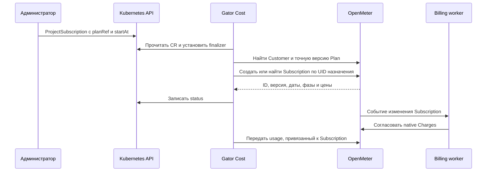

# Назначение плана: ProjectSubscription

`ProjectSubscription` связывает проект с конкретной опубликованной версией
плана в OpenMeter. GVK — `cost.gatorstack.dev/v1alpha1`, Kind
`ProjectSubscription`, resource `projectsubscriptions`, scope Namespaced.
Короткое имя для CLI — `psub`. Namespace одновременно является billing subject
и идентичностью Customer; отдельного поля customer/projectID в spec нет.

`TariffPlan` и `ProjectTariffPlan` описывают ставки. `ProjectSubscription`
назначает их проекту. После включения подписок наличие проектного плана само
по себе не меняет цену проекта: его нужно назначить через ProjectSubscription.

## Поток назначения



Назначение и его фазы читаются через публичный OpenMeter API. Status Kubernetes
является результатом сверки, не вторым источником выбора тарифов. Collector
передаёт количество; отдельный Charge для того же subscription usage он не создаёт.

## Полный spec

| Поле | Тип / обязательность | Поведение |
| --- | --- | --- |
| `planRef` | Объект, обязательно | Конкретный исходный тарифный CR |
| `planRef.kind` | `TariffPlan` или `ProjectTariffPlan`, обязательно | Scope выбранного тарифа |
| `planRef.name` | Имя CR, 1–253 символа, обязательно | Здесь именно metadata.name, не ключ семейства |
| `startAt` | RFC3339 datetime, обязательно | Включённое начало; будущая дата с точностью до целой секунды |
| `endAt` | Необязательный RFC3339 datetime | Исключённое окончание, строго позже начала |

`planRef` и `startAt` неизменяемы. `endAt` можно установить один раз, пока дата
ещё в будущем; установленное значение нельзя изменить или удалить. Для нового
тарифа создайте следующее назначение с непересекающимися датами.

Ссылка на ProjectTariffPlan разрешается только в namespace назначения, а его
projectID должен совпадать с namespace. Ссылки между проектами запрещены.
Назначение должно помещаться в validFrom/validUntil выбранной версии.
План закрепляется по принятому UID/revision и точной native plan/version;
обновление исходного CR не переписывает действующую подписку.

OpenMeter не принимает создание подписки задним числом. Оставляйте запас времени
для публикации плана и reconciliation; проверяйте Ready до startAt. Если дата
прошла, а подписка не создана, контроллер показывает ошибку и не сдвигает дату
на «сейчас» молча. Создайте новое назначение с будущим временем.

## Пример назначения

Предварительно должен быть принят TariffPlan с именем `compute-2027`, периодом
с 1 января 2027 и нужным семейством. Namespace `project-a` должен существовать.

```yaml
apiVersion: cost.gatorstack.dev/v1alpha1
kind: ProjectSubscription
metadata:
  name: compute
  namespace: project-a
spec:
  planRef:
    kind: TariffPlan
    name: compute-2027
  startAt: '2027-01-01T00:00:00Z'
```

```sh
oc --context "$GATOR_CONTEXT" apply -f project-subscription.yaml
oc --context "$GATOR_CONTEXT" -n project-a wait projectsubscription/compute \
  --for=condition=Ready --timeout=120s
oc --context "$GATOR_CONTEXT" -n project-a get projectsubscriptions
oc --context "$GATOR_CONTEXT" -n project-a get projectsubscription compute -o yaml
```

Для индивидуальных ставок замените planRef на
`{kind: ProjectTariffPlan, name: project-a-compute-2027}`. Все ставки выбранного
плана заменяются целиком: отсутствующий CPU/RAM не наследуется из глобального.

## Семейства и смена тарифа

У проекта могут быть отдельные подписки для Compute и S3. Семейство определяется
из выбранного TariffPlan.key или ProjectTariffPlan.globalPlanRef.name.
OpenMeter должен разрешать несколько подписок для своего namespace:

```yaml
productCatalog:
  subscription:
    multiSubscriptionNamespaces:
      - default
credits:
  enabled: true
  enableCreditThenInvoice: true
```

Это настройка OpenMeter, а не Kubernetes namespace проекта. Её должны загрузить
API и billing worker; после изменения Secret перезапустите соответствующие
workloads. Credits включают charge-backed расчёт, но не выдают проекту деньги
или grants автоматически. Внешние платежи настраиваются отдельно.

Два назначения одного семейства не могут пересекаться. Проверяются как CR,
так и сохранённые назначения OpenMeter, включая отменённые после удаления CR.
Для смены обычного тарифа завершите предыдущее назначение в будущий момент T,
затем создайте следующее с startAt=T. Для семейства с месячным бесплатным объёмом
T должен быть началом календарного месяца UTC. Удаление/пересоздание CR не
выдаёт бесплатный объём повторно.

Billing cadence — P1M, anchor — первое число месяца в 00:00 UTC. Proration цен
выключен: цена за единицу потребления не уменьшается из-за неполного месяца.
При первом переходе из отдельного native Charge в середине месяца создаётся
bootstrap-фаза native Plan с оставшимся бесплатным объёмом. С начала следующего
месяца действует обычная фаза с полным лимитом. Остаток закреплён в OpenMeter,
не ведётся отдельным счётчиком Gator.

Если позднее пришёл старый расход и изменил ещё неиспользованный остаток,
доставка останавливается с диагностикой. Сначала согласуйте остаток; не удаляйте
checkpoints и не выдавайте полный лимит вручную. Для перехода остановите внешнюю
нагрузку, дождитесь scrape/delay и пустой очереди доставки до создания подписки.
Если прежний лимит уже полностью исчерпан, дополнительные старые события не
меняют нулевой остаток.

## Status

| Поле | Смысл |
| --- | --- |
| `observedGeneration` | Обработанная generation CR |
| `subscriptionID` | Реальный ID Subscription в OpenMeter |
| `customerID` | Реальный native Customer |
| `plan.id`, `plan.key`, `plan.version` | Закреплённая версия native Plan |
| `family` | Семейство исходного тарифа |
| `phase` | Состояние native Subscription, например scheduled/active/canceled |
| `activeFrom`, `activeUntil` | Фактические границы OpenMeter |
| `conditions[]` | Ready, status, reason, message, observedGeneration, lastTransitionTime |

Ready=True означает синхронизацию. Будущая подписка может одновременно иметь
Ready=True и phase=scheduled. Неподходящий planRef, конфликт, пропущенная дата,
недоступный API или ошибка публикации показываются как SubscriptionError.
Ручная смена цен карточек OpenMeter распознаётся как drift: рабочие цены должны
соответствовать закреплённому плану.

Удаление CR обрабатывает finalizer
`cost.gatorstack.dev/openmeter-subscription`: будущая подписка снимается с
расписания, действующая отменяется с текущего момента. Только после подтверждения
OpenMeter finalizer удаляется. История потребления и финансовые записи остаются.
Не снимайте finalizer вручную при недоступном OpenMeter.

## Переход с отдельных Charges

В CostConfiguration установите неизменяемую будущую границу
`spec.subscriptionsFrom`, предварительно создав Ready назначения для всех
нужных семейств проектов с startAt на этой границе. До неё используется
сохранённый прежний выбор; начиная с неё — только Subscription OpenMeter.
Отсутствие назначения не включает глобальную цену автоматически.

Новые CloudEvents сохраняют type/source/id истории, но имеют
`data.kind: subscription_usage`. Старые Features выбирают только `kind: usage`,
новые — только `subscription_usage` плюс epoch/route/tariff. Поэтому оставшийся
открытым старый Charge не получает новые количества. Архив не переотправляется,
история старого и нового путей доступна через прежний CostReport.

Проверьте отсутствие pending, даты native service periods, рост только
subscription charge и сохранение старых totals. Повторите reconciliation,
рестарт сборщика и доставку того же source/id: количество не должно увеличиться.
