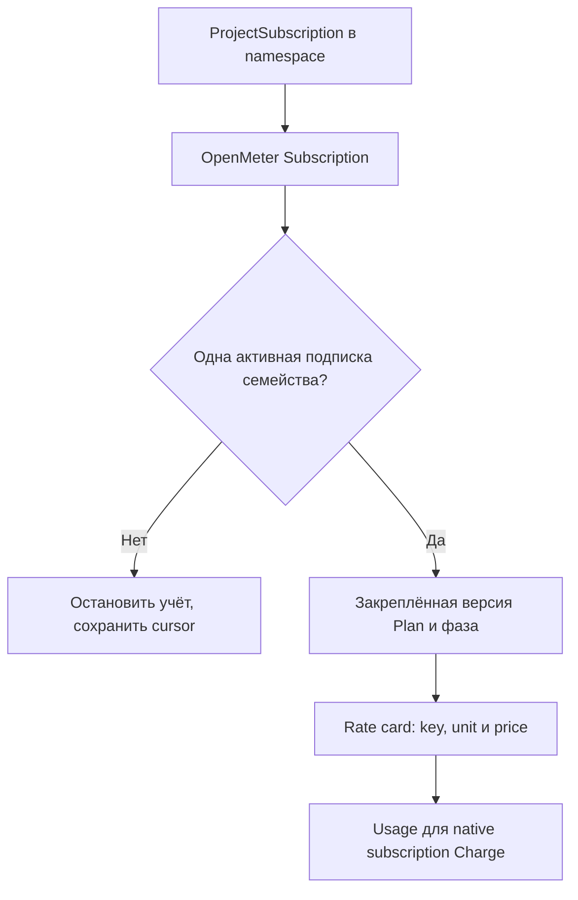

# TariffPlan и ProjectTariffPlan

Все денежные ставки задаются decimal-строками в RUB. OpenMeter считает деньги;
назначенный через ProjectSubscription план закрепляет неизменяемую версию в OpenMeter.

## Семейство и версии

`TariffPlan` — Cluster-scoped, resource `tariffplans`, GVK
`cost.gatorstack.dev/v1alpha1`. Имя CR различает версии, `spec.key` связывает их
в одно семейство. Например, имена `compute-2026`, `compute-2027` могут иметь
общий `key: compute` и непересекающиеся периоды.

**`tariffPlanRef.name` политики и `globalPlanRef.name` проектного плана означают
ключ семейства, а не metadata.name конкретного TariffPlan.** Это позволяет
заранее объявлять следующие версии без изменения политик измерения.

| Поле `TariffPlan.spec` | Обязательность / тип | Смысл |
| --- | --- | --- |
| `key` | Непустая строка, обязательно | Стабильный ключ семейства |
| `displayName` | Необязательно | Публичное имя версии |
| `currency` | Обязательно `RUB` | Валюта |
| `validFrom` | Обязательный RFC3339 datetime | Включённая нижняя граница |
| `validUntil` | Необязательный RFC3339 datetime | Исключённая верхняя граница; строго позже начала |
| `rates` | Непустой список, уникальный по key | **Полный** набор ставок версии |

### Rates

| Поле `rates[]` | Обязательность | Смысл |
| --- | --- | --- |
| `key` | Обязательно | Компонент/тарифный класс |
| `unit` | Обязательно | Точная pricing unit, например `core-minute`, `GB-hour`, `MB` |
| `price` | Обязательно | Неотрицательная цена за единицу |
| `includedQuantity` | Вместе с includedPeriod | Неотрицательный включённый объём |
| `includedPeriod` | Вместе с includedQuantity | Сейчас только `MONTH` |

Формат price/includedQuantity: десятичная строка без знака, экспоненты и дроби
вида `1/3`, до 12 знаков после точки. Нулевая цена допустима. Unit сравнивается
точно; отображаемая подпись единицы не делает конверсию.

## Проектная замена

`ProjectTariffPlan` — Namespaced, resource `projecttariffplans`, та же API version.
У него те же `displayName/currency/validFrom/validUntil/rates`, а вместо `key`:

| Поле | Смысл |
| --- | --- |
| `projectID` | Обязательный billing subject; в проектной модели равен namespace |
| `globalPlanRef.name` | Обязательный ключ заменяемого семейства |

При назначении через ProjectSubscription проектная версия заменяет **весь** набор ставок семейства.
Если RAM отсутствует в проектном rates, она не наследуется из глобального плана.

Даты назначения и действующий набор ставок принадлежат Subscription OpenMeter.
`planRef.name` назначения — имя конкретного CR; ссылки политик остаются ключами
семейства. После включения subscriptionsFrom нет неявного глобального fallback.
Подробнее: [назначение и смена плана](subscriptions.md).

До subscriptionsFrom исторический выбор учитывает validFrom/validUntil,
acceptedAt/retiredAt и приоритет полного проектного замещения. Эти правила
сохраняются для прежних событий и не переписывают назначенную Subscription.

## Неизменяемость

Изменение CR может пройти Kubernetes schema, но быть отклонено контроллером.
Принятая активная/прошлая версия не редактируется задним числом. Меняют будущую
версию либо создают новую с будущим validFrom. Допускается согласованная правка
будущего окончания активного плана; принятые снимки предыдущей версии сохраняются.
Перестановка/переименование позиций тоже может изменить revision — не используйте
редактирование старого снимка как способ смены цены.

Удаление исходного плана не удаляет принятую историю: фиксируется отзыв.
`status.conditions[type=Ready]`, `observedGeneration`, `replacementMode: WholePlan`
показывают принятие. `InvalidPlan` означает, что новый spec не стал рабочим
снимком. После приёма в checkpoint контроллер подтверждает сохранение истории
в OpenMeter до продвижения учёта по новой цене.

## Бесплатный месячный объём

Пример: `price: '1'`, `unit: MB`, `includedQuantity: '10'`,
`includedPeriod: MONTH`. В OpenMeter это graduated цена:

| Объём проекта за календарный месяц UTC | Стоимость |
| --- | --- |
| Первые 10 MB | 0 RUB |
| Каждая следующая MB | 1 RUB |

Входящий и исходящий трафик — разные `rate.key`, поэтому имеют независимые
пороги. Все бакеты проекта суммируются. Scope порога —
`project + family + rate.key + unit + UTC month`, не UID бакета/политики/ревизии.
Перезапуск, новая ревизия и удаление заказа не выдают лимит заново.

Сборщик передаёт полный raw объём; детализация включает бесплатную часть.
`includedQuantity` применяется к metric usage, не к CR-minute policy.
Смену цены/порога существующего monthly charge планируйте на границу UTC-месяца:
несогласованная цена внутри периода отклоняется, чтобы не создать второй лимит.
Переименование key, смена семейства или unit создают другую учётную позицию;
это требует отдельного плана перехода.

При миграции customer metadata хранит остаток первого частичного месяца.
Первый native период использует этот остаток; полностью использованный лимит становится
unit ценой без бесплатного tier. Следующий месяц получает объявленный полный лимит.

## RateCard: архивный GVK

`RateCard` (`ratecards`, Cluster) сохранён для чтения/миграции старой модели.
Native mode его не принимает как источник новых цен. Его полный spec:
`currency: RUB`, непустой `revisions[]` с уникальным `name`, `effectiveFrom`
(исторически `OnActivation` или время) и непустыми `rates[]` (`key`, `unit`, `price`).
Status использует общие `conditions/observedGeneration/message`.

Для нового учёта применяйте TariffPlan/ProjectTariffPlan и тарифную ссылку политики;
создание RateCard не заменяет публикацию native плана.
