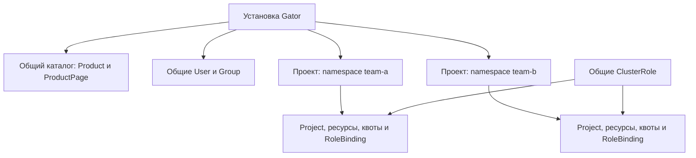

# Основные понятия

## Проект

Проект объединяет ресурсы команды или окружения. В Kubernetes это namespace
с объектом `Project`. Пользователь видит проект, если у него есть право читать
его Project. Один namespace содержит не более одного Project.
Отображаемое название может отличаться от технического имени namespace.

## Продукт и страница

Продукт — сервис в каталоге «Все сервисы», например PostgreSQL или вычисления.
`Product` задаёт название, категорию, логотип и меню. `ProductPage` задаёт
страницу продукта: текст, форму, таблицу ресурсов или раздел IAM.

Каталог является общим для установки консоли. Данные страницы ресурсов
относятся к выбранному проекту. Наличие продукта в каталоге само по себе
не выдаёт права на ресурсы и не устанавливает облачный сервис.

### Ресурсы внутри сервиса

Один IaaS-сервис может объединять виртуальные машины, диски, снимки и SSH-ключи.
Для них не нужны отдельные Product. У каждого типа ресурса могут быть страницы
списка, просмотра, создания и действий; меню сервиса обычно содержит списки.

Для такого описания предусмотрен **ProductResource**. Он связывает один тип ресурса с одним Kubernetes GVK,
определяет создание, статусы и действия. Product задаёт меню, ProductPage —
JSON Schema интерфейса. Одна VM соответствует одному основному CR;
ProductResource описывает тип VM и не создаётся на каждый заказ.

Общие справочники, например flavors, могут находиться вне namespace проекта.
Право читать справочник и право создать ресурс проекта выдаются отдельно.
Страницы с resourceRef поддерживают текущий проект, фиксированный namespace
и cluster scope по установленной CRD. Legacy страницы с x-dashboard-resource
сохраняют источник в namespace проекта. Формы операций поддерживают lookup. См. [страницы ресурсов](operator-manual/resource-pages.md)
и [права общих каталогов](operator-manual/rbac.md#общие-справочники-flavors-и-images).

## Пользователь и группа

Пользователь `User` — учётная запись Gator Dex. Локальный пользователь входит
по паролю; внешний — через настроенного провайдера. `Group` объединяет
пользователей для назначения общего доступа. Создание группы не выдаёт права:
администратор назначает роль пользователю или группе отдельно.

## Роль и назначение

Роль описывает разрешённые действия. Назначение связывает роль с пользователем,
группой или ServiceAccount. В Gator применяются штатные объекты Kubernetes:

| Объект | Что определяет |
| --- | --- |
| `Role` | Разрешения внутри namespace |
| `ClusterRole` | Повторно используемый набор разрешений |
| `RoleBinding` | Назначение Role/ClusterRole в конкретном проекте |
| `ClusterRoleBinding` | Назначение ClusterRole на уровне кластера |

Одна ClusterRole может назначаться в разных проектах с помощью отдельных
RoleBinding. Право на один проект не открывает остальные. Начните с
[предопределённых ролей](reference/roles.md).

## Квота

Квота `ResourceQuota` ограничивает количество объектов проекта. Например,
лимит 20 ConfigMap запрещает создать двадцать первый объект. Консоль показывает
текущее использование и лимит. Квота не задаёт цену и не является бюджетом.

## Учёт и тариф

В Gator Cost правило `MeteringPolicy` определяет, какие ресурсы и поля учитывать.
Глобальный `TariffPlan` задаёт цены, а `ProjectTariffPlan` полностью заменяет
план для указанного проекта на свой период действия.

Потребление группируется по проекту, продукту и инстансу. Инстанс — логический
объект учёта, например конкретная база данных; ему могут соответствовать
несколько Kubernetes-ресурсов. Денежные суммы рассчитывает OpenMeter.

Идентификатор проекта биллинга задаётся правилом учёта. Его связь с namespace
и Project консоли администратор настраивает явно.

## Где хранятся сущности

Технические имена и поля приведены в [справочнике сущностей](reference/entities.md).
